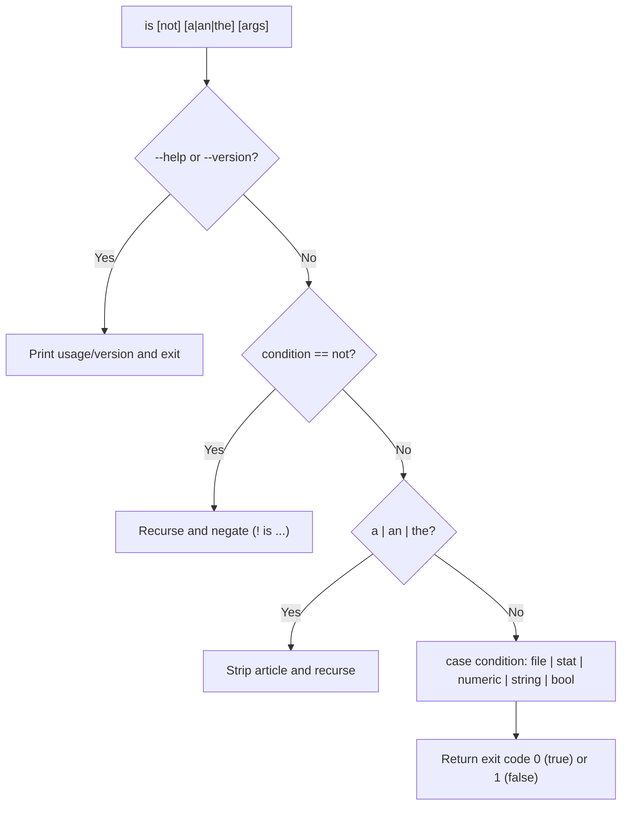

# is.sh

Fancy, human-readable alternative to the standard shell `test` / `[` command for Bash (`v1.1.2` fork of `qzb/is.sh`).

> **Documentation Portal:** [docs/index.md](docs/index.md) ([Tutorials](docs/01-tutorials/index.md), [How-To Guides](docs/02-how-to-guides/index.md), [Reference](docs/03-reference/index.md), [Explanation](docs/04-explanation/index.md))

## Condition Dispatch Architecture



## Example

```sh
source ./is.sh
var=123

if is equal "$var" 123.0; then
    echo "it just works"
fi

if is not a substring "foobar" "$var"; then
    echo "and it's easy to read"
fi
```

## Installation

Source `./is.sh` directly inside your Bash script (exports `is` automatically when sourced) or invoke `./is.sh` as a standalone CLI command:

```sh
# Source into current Bash shell
source ./is.sh

# Or invoke directly
chmod +x ./is.sh
./is.sh equal 42 42.0
```

You can also install from the fork or npm:

```sh
sudo curl -fsSL https://raw.githubusercontent.com/jmrenouard/is.sh/master/is.sh -o /usr/local/bin/is && sudo chmod +x /usr/local/bin/is
```

## Usage Summary

### Conditions

* `is equal $valueA $valueB` (alias: `eq`) — checks whether strings are identical or numerically equal (`awk`).
* `is matching $regexp $value` (alias: `match`) — checks full-line extended regex (`grep -xE`) match against `$value`.
* `is substring $needle $haystack` (alias: `substr`) — checks fixed-string containment (`grep -F`).
* `is empty $value` — true when string length is zero.
* `is number $value` — true for unsigned integer or decimal numbers (`^[0-9]+(\.[0-9]+)?$`).
* `is gt|lt|ge|le $numberA $numberB` — numeric comparisons via `awk`.
* `is file|dir|link|existent|readable|writeable|executable $path` — POSIX file tests (aliases: `directory`, `symlink`, `existing`, `exist`, `exists`).
* `is available $command` (alias: `installed`) — checks whether `$command` exists in `PATH`.
* `is fowner|fgroup|fmountpoint|fempty|fsize|fsizelt|fsizegt|forights $path ...` — GNU Linux `stat -c` checks (alias `fuser` maps to `fowner`).
* `is user $username` — checks whether `$(whoami)` equals `$username`.
* `is tcp_port $port` (aliases: `tport`, `tcp_port_open`) — checks listening TCP ports via `netstat -ltn`.
* `is older|newer $pathA $pathB` — file modification-time comparisons.
* `is true|false $value` — evaluates `true` (`"true"` or `"0"`) vs `false`.

### Negations and Optional Articles

Put `not` and/or optional articles (`a`, `an`, `the`) before any condition:

```sh
is not a number "abc" && echo "not a number"
is an existing ./README.md && echo "found"
```

## Verification

Run the Bash predicate test suite and Python Diátaxis/documentation suite in Linux / WSL:

```sh
bash tests/tests.sh
python3 -m unittest discover -s tests -p "test_*.py" -v
```

## License

MIT ([`LICENSE`](LICENSE))
