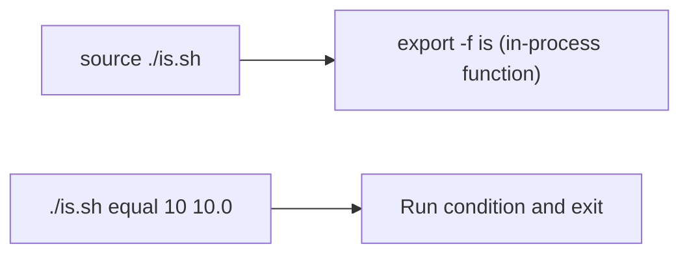

# Tutorial 1: Readable Bash Conditions with `is.sh`

In this tutorial, you source `is.sh` in Bash, evaluate string, numeric, and file conditions, combine `not` with optional articles, and run all 116 built-in predicate tests.

## Prerequisites

- Bash 4+ on Linux or WSL (`gnu` coreutils `stat`, `grep`, `awk`).

## Step 1: Source `is.sh` vs Direct CLI Execution



Source `is.sh` inside a Bash session so `is` becomes available as an exported shell function:

```bash
source ./is.sh
declare -f is | head -n 5
```

> **Shell Session Warning**: Running `is --help` or `is --version` calls `exit` directly inside `is()`, which terminates an interactive sourced shell. Invoke `./is.sh --help` in a subshell or separate process instead.

## Step 2: Evaluate Strings, Numbers, and Regex Predicates

Run equality, regex, substring, and numeric checks in Bash:

```bash
is equal 42 42.0 && echo "Numerically equal"
is gt 10.5 2 && echo "10.5 > 2"
is matching '^[a-z]+$' "hello" && echo "Lowercase letters"
is not a number "abc" && echo "Not numeric"
```

Expected output:

```text
Numerically equal
10.5 > 2
Lowercase letters
Not numeric
```

## Step 3: Check Files, Sizes, and Current User

Inside an isolated `/tmp` sandbox, inspect file predicates (`file`, `dir`, `fsize`, `forights`, `user`):

```bash
tmp=$(mktemp -d) && printf 'hello' > "$tmp/sample.txt" && chmod 640 "$tmp/sample.txt"
./is.sh a file "$tmp/sample.txt"
./is.sh fsize "$tmp/sample.txt" 5
./is.sh forights "$tmp/sample.txt" 640
./is.sh user "$(whoami)"
rm -rf "$tmp"
```

Notice the distinction: `is user <USER>` checks `$(whoami)` with **one** argument, whereas `is fowner <PATH> <USER>` (`fuser`) requires **two** arguments (`<PATH>` and `<USER>`).

## Step 4: Run the Automated Test Suites

Run the built-in 116-test `tests/tests.sh` harness and the Python documentation/predicate verification suite:

```bash
bash tests/tests.sh
python3 -m unittest discover -s tests -p "test_*.py" -v
```

Expected result from `tests/tests.sh`: `all 116 tests passed`.

## Next Steps

- Follow step-by-step operational runbooks in [How-To Guides](../02-how-to-guides/index.md).
- Inspect all aliases and audited caveats in [Reference](../03-reference/predicates-aliases-and-caveats.md).
- Understand recursive dispatch internals in [Explanation](../04-explanation/recursive-dispatch-and-portability.md).
