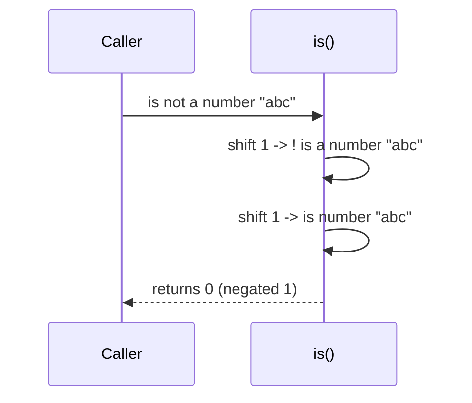

# Recursive Dispatch and Portability

`is.sh` packs a single `161`-line `is()` Bash function capable of acting both as a sourced library function and as an executable command. Three structural mechanisms explain its grammar and platform behavior.

## 1. Recursive Modifier Stripping (`not`, `a`, `an`, `the`)

Because `is()` handles `not` and articles (`a`, `an`, `the`) by calling `shift 1` and recursing on `"${@}"`, modifiers compose naturally in any readable order (`is not an existing ./missing`) without duplicating condition logic inside the `case` statement. Redirecting the entire `case` block `> /dev/null` (`is.sh:L151`) suppresses noisy helper output (`which`, `grep`) so predicates communicate strictly through exit status (`0`/`1`).

## 2. Dual Sourced Function vs Standalone Binary Behavior

Lines `156–161` compare `${BASH_SOURCE[0]}` against `$0`:
- When sourced (`source ./is.sh`), `${BASH_SOURCE[0]}` differs from `$0`, so the file executes `export -f is` and leaves the function in scope.
- When executed directly (`./is.sh equal 1 1`), the strings match, so `is "${@}"` runs and forwards `$?`.
- Caveat: `--help` (`L53`) and `--version` (`L58`) invoke `exit` rather than `return`, assuming CLI invocation rather than interactive sourced lookup.

## 3. Linux `stat -c` and Upstream Fork Divergence

Earlier fork commits (`1709b60`, `5f80758`) experimented with wrapping `gstat` for macOS Homebrew `coreutils`, before `8ccfc22` reverted that wrapper and gated `fowner`/`fsize`/`forights` tests behind `if [ "$(uname)" = "Linux" ]` (`tests/tests.sh:L218`). Consequently, `stat -c` flags (`is.sh:L97-111`) remain Linux GNU-specific even though `.travis.yml` lists `osx`.

- Complete predicate matrix and known issues: [Reference](../03-reference/predicates-aliases-and-caveats.md).
- Operational usage runbook: [How to Validate Files, Numbers, and Services](../02-how-to-guides/validate-files-numbers-and-services.md).
