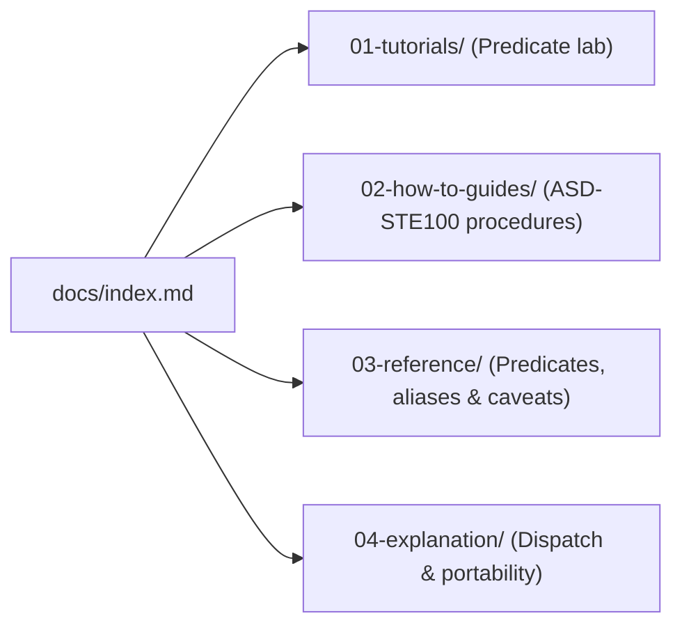

# is.sh Documentation Portal

Documentation portal for **is.sh** (`v1.1.2` fork), structured using the **Diátaxis** framework.

> **Repository Overview:** [README.md](../README.md)

## Quadrants

| Quadrant | Purpose | Entry Point |
| :--- | :--- | :--- |
| **Tutorials** | Hands-on Bash labs using `is.sh` predicates and negation | [01-tutorials/index.md](01-tutorials/index.md) |
| **How-To Guides** | Step-by-step operational checks (ASD-STE100 Issue 9) | [02-how-to-guides/index.md](02-how-to-guides/index.md) |
| **Reference** | Full predicate table, aliases, exit behavior, and known fork caveats | [03-reference/index.md](03-reference/index.md) |
| **Explanation** | Recursive `not`/article dispatch, `BASH_SOURCE`, and `stat` portability | [04-explanation/index.md](04-explanation/index.md) |
